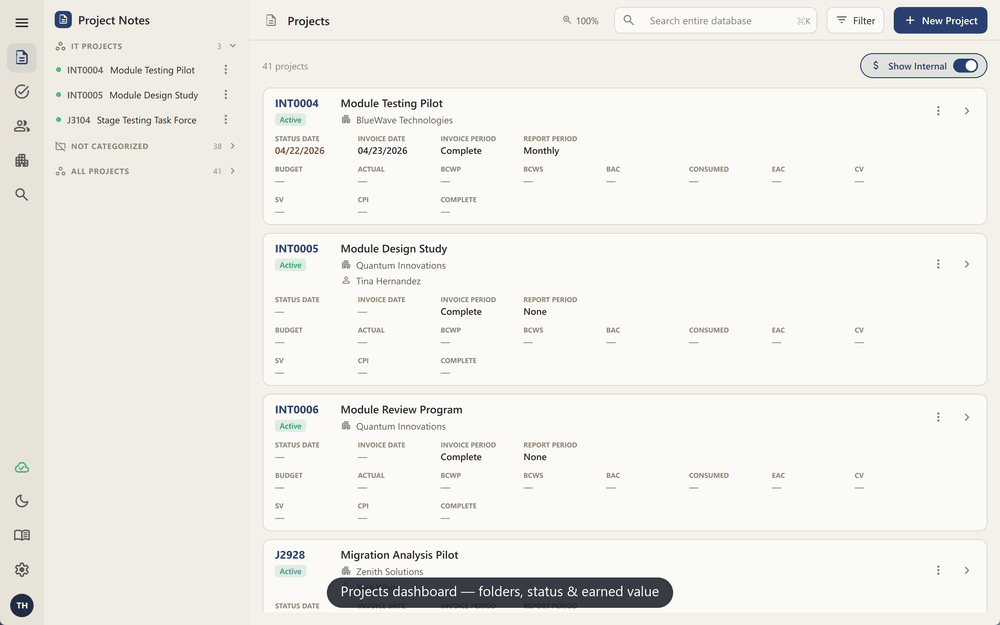

# ProjectNotes

[](https://kestermckinney.github.io/ProjectNotes/)
[](LICENSE)
[](https://gitlab.com/kestermckinney/ProjectNotes/-/releases)



ProjectNotes is a project manager's workspace for notes, action items, project metrics, reporting, and workflow automation. It is designed for people who manage multiple projects and need one place to capture decisions, track follow-up, and keep project communication moving.

## Explore

- [Project site](https://kestermckinney.github.io/ProjectNotes/)
- [Documentation](https://projectnotes.readthedocs.io)
- [High Level Roadmap](https://github.com/users/kestermckinney/projects/4/views/1)
- [Report a bug](https://gitlab.com/kestermckinney/ProjectNotes/-/issues/new)
- [Request an enhancement](https://gitlab.com/kestermckinney/ProjectNotes/-/issues/new)
- [Ask a usage question](https://gitlab.com/kestermckinney/ProjectNotes/-/issues/new)
- [Contributing guide](CONTRIBUTING.md)

## What ProjectNotes Does

- Organizes meeting notes, action items, risks, issues, and change requests in one application.
- Helps project managers maintain project health visibility across multiple teams.
- Supports workflow automation with Python plugins and background tasks.
- Exports project information to PDF and Excel-oriented outputs.
- Runs on Windows, macOS, and Linux, with an iPhone and iPad companion app.
- Backs up and synchronizes your data across all your devices with a [Project Notes Pro](https://www.projectnotespro.com) subscription.

## Install On Linux

Project Notes ships as a signed Flatpak from our GitLab Pages repository. Enable
automatic updates in your desktop software manager, or run `flatpak update`:

```bash
flatpak remote-add --if-not-exists flathub https://flathub.org/repo/flathub.flatpakrepo
flatpak remote-add --if-not-exists projectnotes \
  https://kestermckinney.gitlab.io/ProjectNotes/flatpak/projectnotes.flatpakrepo
flatpak install projectnotes com.projectnotespro.ProjectNotes
```

Prefer a single file? Download `ProjectNotes.flatpak` from the
[latest release](https://gitlab.com/kestermckinney/ProjectNotes/-/releases/permalink/latest).
Full instructions: [Installing on Linux](docs/Introduction/InstallLinux.md).

## Contributing

Contributions are welcome in several forms:

- Bug reports with clear reproduction steps
- Enhancement requests with a real project-management use case
- Documentation fixes and clarification
- Focused pull requests with tests or screenshots when relevant

Please start with [CONTRIBUTING.md](CONTRIBUTING.md) before opening a pull request.

## Building From Source

For build and setup details, see:

- [How to Contribute](https://github.com/kestermckinney/ProjectNotes/wiki/How-to-Contribute)
- [System Requirements](Systemrequirements.md)
- [Developer documentation](docs/index.md)

## License

Copyright (c) Paul McKinney.

Licensed under the [GPL v3.0](LICENSE).
